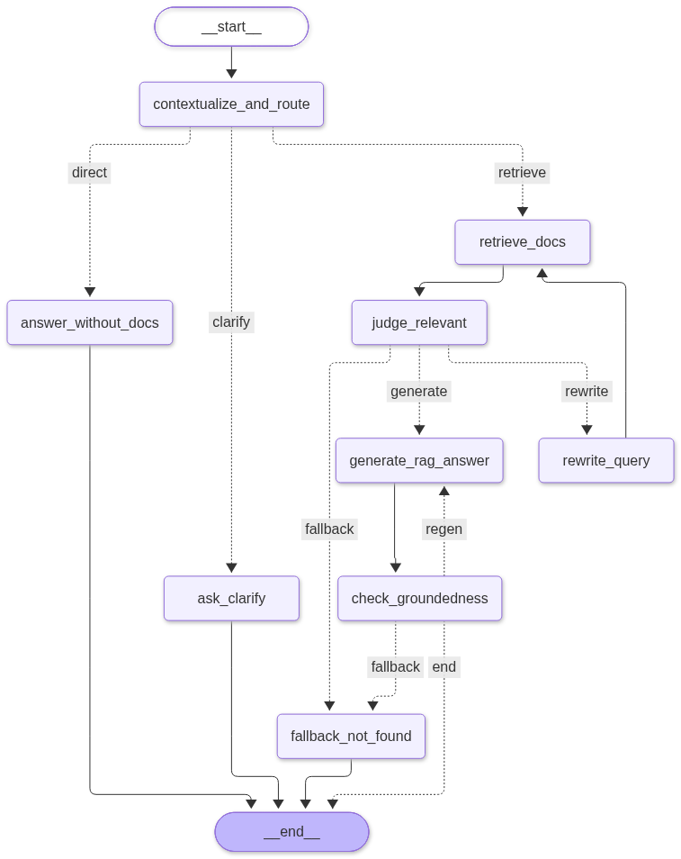

# Agentic RAG

A production-oriented Agentic RAG backend built on **FastAPI**, **PostgreSQL** (`pgvector`), and **LangGraph**. Documents are chunked with source metadata, indexed with local dense embeddings and bilingual full-text search, and retrieved through **Hybrid Search (RRF)** followed by **Cross-Encoder Reranking**. Retrieval can be narrowed with **metadata filtering** (`JSONB @>`), answers carry inline `[Chunk X]` **citations**, and multi-turn conversations are stored as **persistent threads** in PostgreSQL.

## Key Features

- **Hybrid Search (RRF)**: Weighted Reciprocal Rank Fusion of `pgvector` cosine similarity and PostgreSQL full-text ranking (`k=60`, `w_dense=1.3`, `w_sparse=0.7`).
- **Bilingual Full-Text Search**: Generated `tsvector` column combining English and Arabic configurations, indexed with `GIN` and ranked with `ts_rank_cd`.
- **Cross-Encoder Reranking**: Local `cross-encoder/ms-marco-MiniLM-L-6-v2` rescoring over the top 25 fused candidates (`rerank_score_threshold=-1.0`).
- **Metadata Filtering & Self-Querying**: `JSONB @>` pre-filtering applied before dense and sparse scoring; explicit API `filters` are merged with LLM-extracted `"source"` filters, and retrieval falls back to unfiltered search when a filter returns no candidates.
- **Stateful LangGraph Workflow**: Follow-up contextualization, sub-query decomposition, adaptive routing, parallel retrieval, relevance grading with query rewriting, groundedness checks, and safe refusal, with thread state persisted through `AsyncPostgresSaver`.
- **`chunk_id` Integrity**: `chunk_id NOT NULL` in every vector table, returned in all search results, and used as the deduplication key during fusion and multi-query merging.

## Architecture

The diagram below is exported directly from the compiled graph in `src/agents/RAG_Agent.py` (`get_graph().draw_mermaid_png()`). Solid arrows are fixed edges; dashed arrows are conditional branches labeled with their router return value. The Mermaid source is kept alongside it in `docs/langgraph_architecture.mmd`.



### Request Entry

`POST /api/v1/nlp/agent/answer/{project_id}` invokes the compiled graph with `messages`, `project_id`, and optional `filters`. The request `thread_id` keys the PostgreSQL checkpoint, so earlier turns in the same thread are loaded into `messages` before the graph starts.

### Nodes

| Node | Purpose | State Written |
|---|---|---|
| `contextualize_and_route` | Rewrites follow-ups into a standalone `query`, produces 1-3 search `queries`, extracts a `"source"` filter when a document or contract is named, and picks a route. Resets per-turn counters. | `query`, `queries`, `extracted_filters`, `route`, `documents`, `retry_count`, `gen_retry_count` |
| `retrieve_docs` | Merges `extracted_filters` with explicit `filters`, runs every sub-query concurrently through hybrid search + reranking, deduplicates, and keeps the top 8 chunks labeled `[Chunk N \| id=...]`. Repeats the search without filters if the filtered pass returns nothing. | `documents` |
| `judge_relevant` | LLM grader that marks the chunks relevant if they help answer any part of the question. Empty `documents` are marked irrelevant without an LLM call. | `is_relevant` |
| `rewrite_query` | Generates 1-3 alternative queries (expanded acronyms, legal synonyms), clears `extracted_filters`, and increments the retry counter. | `queries`, `extracted_filters`, `retry_count` |
| `generate_rag_answer` | Writes a grounded answer from the chunks with ASCII `[Chunk X]` citations, entity matching against the named party, and language lock. Adds a stricter instruction on regeneration. | `answer` |
| `check_groundedness` | LLM verifier that accepts paraphrase and multi-chunk synthesis but rejects unsupported facts. Commits the answer to `messages` only when grounded. | `is_grounded`, `gen_retry_count`, `messages` |
| `answer_without_docs` | Replies to greetings and small talk without retrieval. | `answer`, `messages` |
| `ask_clarify` | Asks one clarifying question for ambiguous document requests. | `answer`, `messages` |
| `fallback_not_found` | Returns a fixed "not found in the documents" response. | `answer`, `messages` |

### Edges and Conditional Branches

1. `__start__` -> `contextualize_and_route` (fixed).
2. `contextualize_and_route` branches on `route_query`:
   - `direct` -> `answer_without_docs` -> `__end__`
   - `clarify` -> `ask_clarify` -> `__end__`
   - `retrieve` -> `retrieve_docs`
3. `retrieve_docs` -> `judge_relevant` (fixed).
4. `judge_relevant` branches on `decision_after_judgement`:
   - `generate` when `is_relevant` is true -> `generate_rag_answer`
   - `rewrite` when irrelevant and `retry_count < MAX_RETRIES` (2) -> `rewrite_query` -> `retrieve_docs` (loop)
   - `fallback` when retries are exhausted -> `fallback_not_found` -> `__end__`
5. `generate_rag_answer` -> `check_groundedness` (fixed).
6. `check_groundedness` branches on `decision_after_groundedness`:
   - `end` when `is_grounded` is true -> `__end__`
   - `regen` when ungrounded and `gen_retry_count <= MAX_GEN_RETRIES` (2) -> `generate_rag_answer` (loop)
   - `fallback` when regeneration attempts are exhausted -> `fallback_not_found` -> `__end__`

Both loops are bounded by monotonically increasing counters, so every path terminates at `__end__`, and every terminal path appends exactly one `AIMessage` to the persisted thread.

### Retrieval Data Flow (inside `retrieve_docs`)

```text
sub-query + metadata_filter
  -> NLPController.search_vector_db_collections(search_mode="hybrid", use_reranker=True)
       -> PGVectorProvider.search_by_vector   (dense,  WHERE metadata @> :metadata_filter)
       -> PGVectorProvider.sparse_search      (GIN FTS, AND metadata @> :metadata_filter)
       -> reciprocal_rank_fusion              (k=60, w_dense=1.3, w_sparse=0.7)
       -> CrossEncoderReranker.rerank         (top 25 candidates, threshold -1.0)
  -> "[id=<chunk_id>]\n<text>" strings, merged across sub-queries
```

## Evaluation Results (CUAD Benchmark - 55 Queries)

Benchmarked end to end with `evals/eval_rag_agent.py` on 55 questions over 270 chunks from 10 CUAD contracts (29 answerable, 15 hard / hidden, 11 unanswerable), scored by an LLM judge. Indexing chunks with `"source"` metadata and enabling self-querying filters raised answerable accuracy and citation coverage while keeping refusal perfect and errors at zero.

| Metric | Baseline | Metadata Filtering |
|---|---:|---:|
| Answerable Accuracy | 84.09% | **86.36%** |
| Hard / Hidden Accuracy | 86.67% | **86.67%** |
| Refusal Rate | 100.00% | **100.00%** |
| Citation Coverage | 86.36% | **88.64%** |
| Avg Latency | 6567 ms | 7137 ms |
| Errors | 0 | **0** |

## Project Structure

```text
.
├── docker/
│   ├── .env.example                     # Docker PostgreSQL password template
│   └── docker-compose.yml               # pgvector/pgvector:0.8.0-pg17 service
├── docs/
│   ├── langgraph_architecture.mmd       # Mermaid source exported from the compiled graph
│   └── langgraph_architecture.png       # Rendered LangGraph agent diagram
├── evals/
│   ├── agent_eval_results.json          # Saved LangGraph agent benchmark metrics
│   ├── cuad_dataset.json                # 55-query, 270-chunk CUAD benchmark dataset
│   ├── eval_rag_agent.py                # End-to-end LangGraph agent evaluation with LLM judge
│   ├── results.json                     # Saved retrieval benchmark metrics
│   └── run_eval.py                      # Retrieval eval & project_id=99 indexer
├── src/
│   ├── main.py                          # FastAPI entrypoint, client setup & AsyncPostgresSaver
│   ├── .env.example                     # Application environment template
│   ├── requirements.txt                 # Python dependencies
│   ├── agents/
│   │   └── RAG_Agent.py                 # LangGraph adaptive & corrective RAG workflow
│   ├── controllers/                     # Data, Process, Project, NLPController & RetrievalFusion
│   ├── helpers/                         # Pydantic Settings (config.py)
│   ├── models/                          # SQLAlchemy models (DataChunk JSONB) & Alembic migrations
│   ├── routes/                          # FastAPI routers (/api/v1, /api/v1/data, /api/v1/nlp)
│   │   └── schemes/                     # Pydantic request schemas (SearchhRequest, AgentRequest)
│   └── stores/
│       ├── llm/                         # OpenAI, CoHere & LocalEmbeddingProvider + prompt templates
│       ├── reranker/                    # CrossEncoderReranker
│       └── vectordb/                    # VectorDBInterface, PGVectorProvider & QdrantDBProvider
└── README.md
```

## Quick Start & API Usage

1. **Install dependencies and configure the environment:**
   ```bash
   pip install -r src/requirements.txt
   cp src/.env.example src/.env
   # Set PostgreSQL credentials, GENERATION_BACKEND, GENERATION_MODEL_ID,
   # EMBEDDING_BACKEND, EMBEDDING_MODEL_ID, EMBEDDING_MODEL_SIZE, and API keys in src/.env
   ```

2. **Start PostgreSQL (`pgvector`) and run Alembic migrations:**
   ```bash
   cp docker/.env.example docker/.env   # Set POSTGRES_PASSWORD
   cd docker && docker compose up -d pgvector && cd ..
   cd src/models/db_schemes/rag_project
   cp alembic.ini.example alembic.ini   # Set sqlalchemy.url
   alembic upgrade head
   cd ../../../..
   ```

3. **Start the FastAPI server:**
   ```bash
   cd src
   uvicorn main:app --reload --host 0.0.0.0 --port 5000
   ```
   LangGraph checkpoint tables are created automatically on startup (`AsyncPostgresSaver.setup()`).

## API Endpoints

| Method | Endpoint | Description |
|---|---|---|
| `GET` | `/api/v1/` | Welcome check returning `APP_NAME` and `APP_VERSION` |
| `POST` | `/api/v1/data/upload/{project_id}` | Upload a `.txt` or `.pdf` file |
| `POST` | `/api/v1/data/process/{project_id}` | Chunk uploaded files and store them with `{"source": file_id}` metadata |
| `POST` | `/api/v1/nlp/index/push/{project_id}` | Embed chunks and index them into `pgvector` + `GIN` FTS |
| `GET` | `/api/v1/nlp/index/info/{project_id}` | Inspect vector collection info and record count |
| `POST` | `/api/v1/nlp/index/search/{project_id}` | Search chunks (`dense`, `sparse`, or `hybrid`, optional reranker and `filters`) |
| `POST` | `/api/v1/nlp/index/answer/{project_id}` | One-shot retrieval and LLM answer (`filters` supported) |
| `POST` | `/api/v1/nlp/agent/answer/{project_id}` | Stateful LangGraph agent keyed by `thread_id`, with optional `filters` |

## Agent Request Example (with Metadata Filtering)

```bash
curl -X POST "http://127.0.0.1:5000/api/v1/nlp/agent/answer/99" \
  -H "Content-Type: application/json" \
  -d '{
    "text": "Which state laws govern the hosting agreement with VOTOCAST?",
    "thread_id": "demo-thread-1",
    "filters": {
      "source": "VitalibisInc"
    }
  }'
```

The response includes `signal`, `answer`, `route`, and `retry_count`. Reusing the same `thread_id` continues the conversation with full history; omitting `filters` lets the agent extract a `"source"` filter itself when the question names a specific document.

## Running Evaluations

1. **Index the CUAD corpus into `project_id=99` and run the retrieval benchmark:**
   ```bash
   python evals/run_eval.py --project-id 99
   ```

2. **Run the end-to-end LangGraph agent benchmark against the running server:**
   ```bash
   python evals/eval_rag_agent.py --base-url http://127.0.0.1:5000 --project-id 99
   ```
   Each question uses an isolated `thread_id`. Results are written to `evals/agent_eval_results.json`. Use `--limit N` for a quick smoke test.

## Tech Stack

**API & Orchestration**
- FastAPI, Uvicorn (`uvicorn[standard]`), `python-multipart`
- Pydantic Settings, `python-dotenv`
- LangGraph with `langgraph-checkpoint-postgres` (`AsyncPostgresSaver`), `langchain-core` messages

**Databases & Vector Search**
- PostgreSQL 17 with `pgvector` 0.8.0 (Docker image `pgvector/pgvector:0.8.0-pg17`)
- SQLAlchemy 2.0 (async) with `asyncpg`, Alembic migrations
- `psycopg` 3 and `psycopg-pool` for the checkpointer, `psycopg2-binary`
- Qdrant (`qdrant-client`) as an alternative vector backend

**ML / Embeddings / Reranking**
- Local embeddings: `BAAI/bge-base-en-v1.5` (768-dim, benchmark) or `BAAI/bge-small-en-v1.5` (384-dim, default template)
- Cross-encoder reranking: `cross-encoder/ms-marco-MiniLM-L-6-v2` via `sentence-transformers`
- Generation through an OpenAI-compatible API (`openai` SDK, e.g., Groq) or Cohere (`cohere`)

**Document Processing & Tooling**
- PyMuPDF and LangChain document loaders, `aiofiles` for streamed uploads
- `pytest` for testing
- Declared in `requirements.txt` for planned background processing and monitoring: Celery, Redis, Flower, `prometheus-client`, `starlette-exporter`, `fastapi-health`, NLTK
